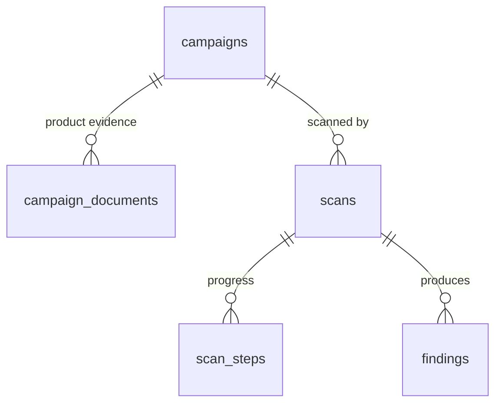

# Database (Supabase)

Schema for ClaimGuard X: campaigns, scans, scan steps and findings, plus file storage.
Everything is in `supabase/migrations/20261107120000_init.sql`. TypeScript types are in `src/db/`.

## Data model



| Table | What it holds | Used by |
|---|---|---|
| `campaigns` | ad text, ad image (storage path), landing URL, product category (`cosmetics` / `general`), `is_demo` | NewScanScreen |
| `campaign_documents` | PDFs (technical sheet, certification, study): storage path + extracted text for the model | NewScanScreen, AI context |
| `scans` | one pipeline run: status, score 0–100, a snapshot of the ad text / URL, `offer` (extractOffer result), screenshot paths | ScanReport, ScanHistoryScreen |
| `scan_steps` | one row per check (`capturePage`, `checkLinks`, …, AI steps): status, duration, findings count | ScanProgress (Realtime) |
| `findings` | one `Finding` (the shared type from rule 3): category, severity, title, claim, evidence (jsonb), rule, risk, fix, confidence | FindingCard, EvidenceView |

The `scan_overview` view gives one row per scan with counts per severity and per category, for the history list and the report header.

The `Finding` type maps to `findings` one-to-one. `Finding.id` is stored as `finding_key` (unique per scan), and `evidence` is stored as jsonb. Use `findingToRow` / `rowToFinding` from `src/db/findings.ts`, so the UI keeps receiving the same shape as `mock/findings.json`.

## Score

`public.compute_scan_score(scan_id)` = 100 − (15 × critical + 7 × high + 3 × medium + 1 × low), floored at 0.
This is a proposal. The base can compute the score differently and write it to `scans.score`.

## Security (RLS)

- Each user sees only their own campaigns, scans and findings (`owner_id = auth.uid()`, set by default).
- **Demo campaigns** (`is_demo = true`) can be read by everyone, logged out included, so the jury demo works without an account. Users cannot mark their own campaigns as demo.
- Users can create campaigns, upload documents and start scans (status `queued`). **Only the pipeline**, running server-side with the `service_role` key, writes `scan_steps`, `findings`, the score and screenshots. Never expose that key in the browser.
- Deleting a campaign deletes its documents, scans, steps and findings.

## Storage

Three private buckets. Path: `<owner_id>/<campaign_id>/<file>`. Demo files go under `demo/<campaign_id>/<file>`.

| Bucket | Content | Who writes |
|---|---|---|
| `ad-images` | ad image (png/jpg/webp/gif, ≤10 MB) | user |
| `product-documents` | PDF / txt (≤20 MB) | user |
| `screenshots` | desktop/mobile captures from capturePage | pipeline only |

Read files through signed URLs (`supabase.storage.from(bucket).createSignedUrl(path, 3600)`).

## Realtime

`scans` and `scan_steps` are in the `supabase_realtime` publication. ScanProgress can subscribe:

```ts
supabase.channel(`scan-${scanId}`)
  .on('postgres_changes', { event: '*', schema: 'public', table: 'scan_steps', filter: `scan_id=eq.${scanId}` }, onStep)
  .subscribe();
```

## How the pipeline writes a scan

```ts
import { createClient } from '@supabase/supabase-js';
import type { Database } from '@/lib/db/database.types';
import { findingToRow } from '@/lib/db/findings';

const db = createClient<Database>(process.env.NEXT_PUBLIC_SUPABASE_URL!, process.env.SUPABASE_SERVICE_ROLE_KEY!);

await db.from('scans').update({ status: 'running', started_at: new Date().toISOString() }).eq('id', scanId);
// after each module:
await db.from('scan_steps').upsert({ scan_id: scanId, name: 'checkLinks', status: 'completed', duration_ms: r.durationMs, findings_count: r.findings.length }, { onConflict: 'scan_id,name' });
await db.from('findings').upsert(r.findings.map((f) => findingToRow(f, scanId, 'checkLinks')), { onConflict: 'scan_id,finding_key' });
// at the end:
const { data: score } = await db.rpc('compute_scan_score', { p_scan_id: scanId });
await db.from('scans').update({ status: 'completed', score, completed_at: new Date().toISOString() }).eq('id', scanId);
```

## Setup

```bash
npx supabase init                 # creates supabase/config.toml (once, in the base repo)
npx supabase start                # local Supabase in Docker
npx supabase db reset             # applies migrations + supabase/seed.sql
# hosted project:
npx supabase link --project-ref <ref> && npx supabase db push
npx supabase gen types typescript --linked > src/db/database.types.ts
```

`.env.local` (not committed): `NEXT_PUBLIC_SUPABASE_URL`, `NEXT_PUBLIC_SUPABASE_ANON_KEY`, `SUPABASE_SERVICE_ROLE_KEY`.

## Demo data (seed)

`supabase/seed.sql` is generated from the scanner fixtures:

```bash
npx tsx scripts/fixtures-to-seed.ts fixtures supabase/seed.sql
```

Each fixture folder that has `findings.json` and `summary.json` becomes one demo campaign with one completed scan. IDs are deterministic, so re-running is safe. When Colleague 4's campaigns are scanned into `fixtures/<campaign>/`, re-run the script and they appear in the app.

## Moving to the base

`supabase/` goes as is. `src/db/` goes to `lib/db/`. If the official `Finding` type differs from `src/types.ts`, update the `findings` columns and `src/db/findings.ts`.

## Tested

The migration and seed were run on Postgres 16 (PGlite) with stubs for Supabase `auth` and `storage`. 19 checks passed: demo data is readable while logged out; users are isolated from each other; users cannot write findings or upload screenshots; `confidence` and the landing URL are validated; `insert(...).select()` works; deleting a campaign cascades. Not tested yet on a real Supabase project.
